<div align="center">



# 👋 Hola, soy Edwar Gonzalez

### 💻 Full Stack Developer Freelance | 🏢 Creador de EG Engineering Group | ⚙️ n8n & IA | 🔐 Cybersecurity


<br>


</div>

---

## 👨‍💻 Sobre mí

Soy **desarrollador freelance remoto** y **creador de EG Engineering Group**. Ofrezco desarrollo web, sistemas de gestión, automatizaciones y asesoramiento técnico para negocios y emprendedores.

Me interesa crear aplicaciones funcionales, seguras y escalables con tecnologías como **Java, Spring Boot, Python, Django, PHP, Laravel, Node.js, React, Tailwind CSS y SQL**, integrando **Inteligencia Artificial** y automatizaciones cuando aporten valor al negocio.

* 🔭 Actualmente desarrollo proyectos privados de sistemas web y automatizaciones.
* 🌱 Sigo actualizando mis conocimientos en **Spring Boot, React, IA, n8n y ciberseguridad**.
* 🗄️ Trabajo con **MySQL, PostgreSQL y SQL** para el diseño y consulta de bases de datos.
* 🔐 Me interesa el análisis de vulnerabilidades y la seguridad de aplicaciones web.
* 🌐 Tengo conocimientos en configuración y administración de redes.
* 🐧 Me interesa la administración de sistemas Linux.
* 🤝 Estoy abierto a colaborar en proyectos tecnológicos y a brindar asesoría remota.
* 🚀 Mi objetivo es consolidarme como desarrollador freelance full stack, especializado en automatización y seguridad.

---

## 🏢 EG Engineering Group

Soy el creador de **EG Engineering Group**, con servicios de desarrollo y consultoría remota:

* 🌐 Landing pages
* 🛒 Tiendas online
* 🧩 Sistemas de gestión a medida
* ⚙️ Automatizaciones con n8n
* 🤖 Bots de atención y automatización
* 🧭 Asesoramiento técnico y desarrollo remoto

---

## 🛠️ Tecnologías y herramientas

### 🎨 Frontend

<div align="center">


</div>

<br>

### ⚙️ Backend

<div align="center">


</div>

<br>

### 🗄️ Bases de datos

<div align="center">


<br><br>


</div>

<br>

### 🤖 Automatización e Inteligencia Artificial

<div align="center">


</div>

<br>

### 🔧 Herramientas y sistemas

<div align="center">


</div>

<br>

### 💻 Tecnologías principales

<div align="center">


</div>

---

## 📊 Estadísticas de GitHub

<div align="center">


</div>

---

## 🔥 Racha de contribuciones

<div align="center">

<a href="https://git.io/streak-stats">
  
</a>

</div>

---

## 📈 Actividad de contribuciones

<div align="center">


</div>

---

## 🚀 Áreas de interés

```text
💻 Desarrollo Full Stack freelance
🎨 Landing pages y tiendas online
🧩 Sistemas de gestión (ERP) a medida
☕ Java y Spring Boot
🐍 Python y Django
🐘 PHP, Laravel y Blade
🟨 Node.js
⚛️ React y Tailwind CSS
🗄️ SQL, MySQL y PostgreSQL
⚙️ Automatizaciones con n8n
🤖 Bots e Inteligencia Artificial
🌐 Redes y telecomunicaciones
🔐 Ciberseguridad y seguridad en aplicaciones web
🐧 Administración de sistemas Linux
```

---

## 📂 Proyectos destacados

<table>
  <tr>
    <td width="50%">
      <h3 align="center">🏢 ERP con Java y Spring Boot</h3>
      <p align="center">
        Sistema ERP desarrollado con Java y Spring Boot, desplegado.
      </p>
      <p align="center">
        
      </p>
    </td>
    <td width="50%">
      <h3 align="center">📅 Sistema de gestión de citas</h3>
      <p align="center">
        Sistema de gestión de citas desarrollado con PHP, Laravel y Blade.
      </p>
      <p align="center">
        
      </p>
    </td>
  </tr>
  <tr>
    <td width="50%">
      <h3 align="center">🐍 Restaurante con Python y Django</h3>
      <p align="center">
        Aplicación web desarrollada con Python, Django y una base de datos SQL.
      </p>
      <p align="center">
        <a href="https://github.com/edwargreoz/Restaurante_08">
          
        </a>
      </p>
    </td>
    <td width="50%"></td>
  </tr>
</table>

---

## 🎯 Objetivos profesionales

* Consolidar mi oferta de landing pages, tiendas online, sistemas de gestión y automatizaciones.
* Crear sistemas empresariales escalables con Java, Spring Boot y Django.
* Integrar Inteligencia Artificial y automatización en procesos de negocio.
* Mantener la seguridad como parte de cada desarrollo.
* Ofrecer desarrollo y asesoría remota a negocios y emprendedores.

---

## 🤝 Conecta conmigo

<div align="center">

💼 **Disponible para trabajo freelance remoto:** desarrollo, automatización y asesoramiento.

<br>

<a href="https://www.linkedin.com/in/edwar-agustín-gonzález-requejo-577956420">
  
</a>

<a href="mailto:gonzalzedwar@gmail.com">
  
</a>

<a href="https://github.com/edwargreoz">
  
</a>

</div>
